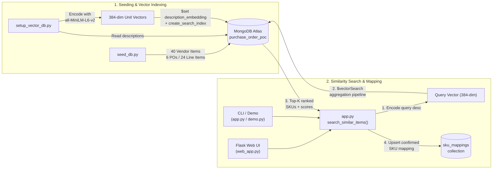
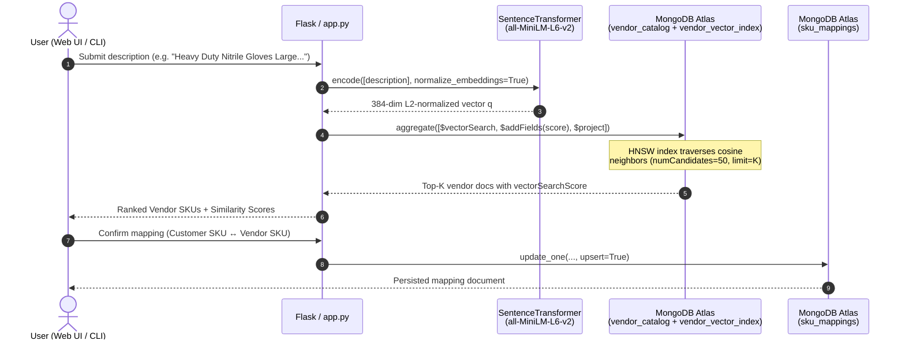

# System Architecture & Data Flow

## High-Level Architecture

The POC uses **MongoDB Atlas** as both the operational document store and the vector search engine, eliminating the need for a separate vector database.

## `$vectorSearch` Query Lifecycle

## Components

| Component | File | Responsibility |
| :--- | :--- | :--- |
| Config & Clients | [`config.py`](../config.py) | Loads `.env`, provides `get_mongo_db()` and cached `get_embedding_model()`. |
| Data Seeder | [`seed_db.py`](../seed_db.py) | Seeds `vendor_catalog`, `customer_purchase_orders`, `customer_po_items`, and indexes `sku_mappings`. |
| Vector Setup | [`setup_vector_db.py`](../setup_vector_db.py) | Computes `description_embedding` on all items and builds `vendor_vector_index` & `customer_vector_index`. |
| Core Engine & CLI | [`app.py`](../app.py) | Runs `$vectorSearch` pipelines, batch PO matching, and saves mappings to `sku_mappings`. |
| Web UI & API | [`web_app.py`](../web_app.py) | Serves the 4-tab demo UI at `http://127.0.0.1:5000` and REST endpoints. |
| Terminal Demo | [`demo.py`](../demo.py) | Guided step-by-step terminal presentation script. |
