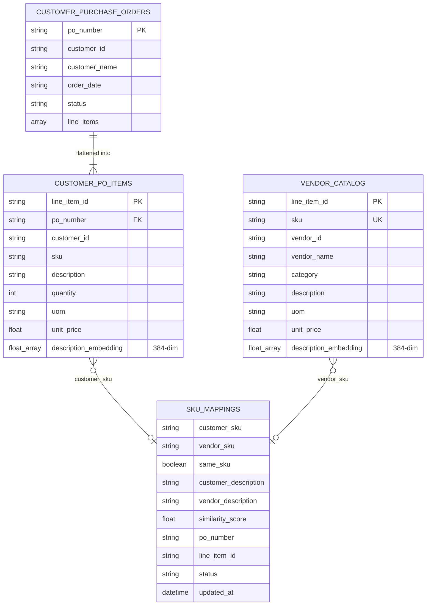

# Database Representation & Schema (`purchase_order_poc`)

## Entity-Relationship Diagram



## Collections & Indexes

### 1. `vendor_catalog` (40 documents)
- **Standard Index**: `sku` (unique, ascending)
- **Atlas Vector Search Index**: `vendor_vector_index` (`type: "vectorSearch"`)
  ```json
  {
    "fields": [
      {
        "type": "vector",
        "path": "description_embedding",
        "numDimensions": 384,
        "similarity": "cosine"
      },
      { "type": "filter", "path": "category" },
      { "type": "filter", "path": "vendor_id" }
    ]
  }
  ```

### 2. `customer_purchase_orders` (6 documents) & `customer_po_items` (24 documents)
- `customer_purchase_orders` stores the full PO header with embedded `line_items`.
- `customer_po_items` stores one document per line item so `$vectorSearch` can rank individual line items directly.
- **Atlas Vector Search Index**: `customer_vector_index` (`type: "vectorSearch"`)
  ```json
  {
    "fields": [
      {
        "type": "vector",
        "path": "description_embedding",
        "numDimensions": 384,
        "similarity": "cosine"
      },
      { "type": "filter", "path": "po_number" },
      { "type": "filter", "path": "customer_id" }
    ]
  }
  ```

### 3. `sku_mappings` (24 documents)
- **Standard Index**: Compound unique index on `(customer_sku, vendor_sku)` so repeated mappings cleanly upsert without duplicates.

## Sample Document Comparison (Cross-SKU Match)

**Customer PO Line Item (`customer_po_items`)**:
```json
{
  "line_item_id": "CLI-101-2",
  "po_number": "PO-2026-101",
  "sku": "CUST-GLV-LRG",
  "description": "Heavy Duty Nitrile Gloves Large Blue Powder Free 100ct",
  "quantity": 25,
  "uom": "BOX"
}
```

**Matched Vendor Catalog Item (`vendor_catalog`)**:
```json
{
  "line_item_id": "VLI-005",
  "sku": "VND-GLV-L100",
  "vendor_name": "SafePro PPE Distributors",
  "category": "Safety",
  "description": "Disposable Nitrile Exam Gloves, Size L, Blue, Powder-Free, Box of 100",
  "uom": "BOX"
}
```

**Resulting Mapping (`sku_mappings`)**:
```json
{
  "customer_sku": "CUST-GLV-LRG",
  "vendor_sku": "VND-GLV-L100",
  "same_sku": false,
  "similarity_score": 0.7736,
  "customer_description": "Heavy Duty Nitrile Gloves Large Blue Powder Free 100ct",
  "vendor_description": "Disposable Nitrile Exam Gloves, Size L, Blue, Powder-Free, Box of 100",
  "po_number": "PO-2026-101",
  "line_item_id": "CLI-101-2",
  "status": "MAPPED"
}
```
