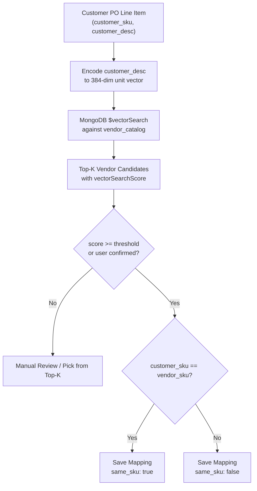

# The Math Behind Semantic Similarity & SKU Mapping

## 1. Dense Text Embeddings (`all-MiniLM-L6-v2`)

Every item description $t$ (from either the Customer PO or Vendor Catalog) is passed through the `all-MiniLM-L6-v2` transformer encoder, which maps variable-length text into a fixed 384-dimensional vector $\mathbf{u} \in \mathbb{R}^{384}$ via mean pooling over token embeddings.

During encoding, we set `normalize_embeddings=True`, which applies **L2 normalization**:

$$\hat{\mathbf{u}} = \frac{\mathbf{u}}{\|\mathbf{u}\|_2} = \frac{\mathbf{u}}{\sqrt{\sum_{i=1}^{384} u_i^2}}$$

Every stored `description_embedding` in MongoDB therefore lies on the 384-dimensional unit hypersphere ($\|\hat{\mathbf{u}}\|_2 = 1$).

---

## 2. Cosine Similarity & Dot Product Equivalence

For a query vector $\hat{\mathbf{q}}$ and a catalog vector $\hat{\mathbf{d}}$, **Cosine Similarity** measures the cosine of the angle $\theta$ between them:

$$\text{cos}(\theta) = \frac{\hat{\mathbf{q}} \cdot \hat{\mathbf{d}}}{\|\hat{\mathbf{q}}\|_2 \, \|\hat{\mathbf{d}}\|_2}$$

Because both vectors are L2-normalized ($\|\hat{\mathbf{q}}\|_2 = \|\hat{\mathbf{d}}\|_2 = 1$), Cosine Similarity simplifies to a single dot product:

$$\text{cos}(\theta) = \sum_{i=1}^{384} \hat{q}_i \, \hat{d}_i \in [-1, 1]$$

- $\text{cos}(\theta) \approx 1.0$: Descriptions express the same product/meaning (even with reordered words, abbreviations like `SS304` vs `Stainless Steel`, or unit conversions like `1 Liter` vs `1000mL`).
- $\text{cos}(\theta) \approx 0.0$: Unrelated items.

---

## 3. MongoDB Atlas `vectorSearchScore`

MongoDB Atlas Vector Search indexes vectors using **HNSW (Hierarchical Navigable Small World)** graphs for fast Approximate Nearest Neighbor (ANN) retrieval. When `similarity: "cosine"` is configured on the index, Atlas normalizes the cosine similarity into a non-negative ranking score in $[0, 1]$:

$$\text{vectorSearchScore} = \frac{1 + \text{cos}(\theta)}{2} \in [0, 1]$$

The aggregation pipeline retrieves `numCandidates` (set to $\max(10K, 50)$) approximate neighbors from the HNSW graph, computes exact scores for those candidates, and returns the top `limit = K` documents sorted descending by `vectorSearchScore`.

---

## 4. SKU Mapping Logic: Same-SKU vs. Cross-SKU

### Handling Near-Misses (Why Top-K Matters)
Pure semantic embeddings capture meaning well, but numeric spec differences (e.g., `500mL` vs `1000mL`, `Size M` vs `Size L`, `M6` vs `M8`) can produce very close cosine scores:
- `"Isopropyl Alcohol 99% ... 1 Liter"` vs `"IPA ... 500mL"` (`0.7204`) and `"IPA ... 1000mL"` (`0.7199`).
- Returning **Top-K** candidates in the UI/CLI lets a reviewer confirm the exact spec before persisting the mapping to `sku_mappings`.
